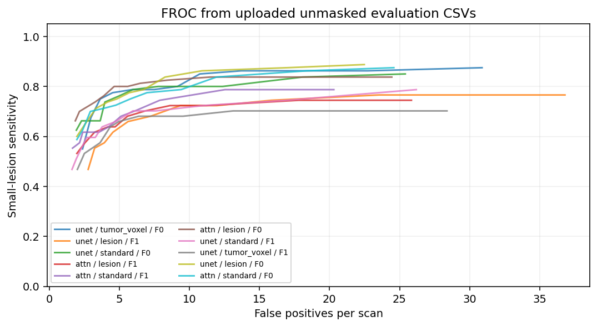
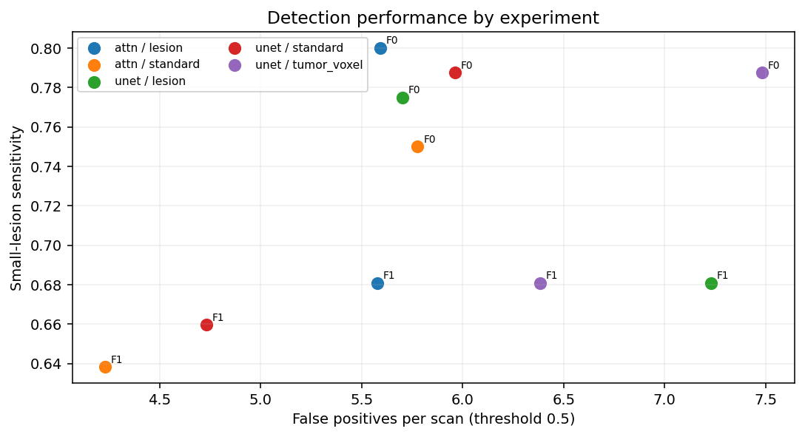
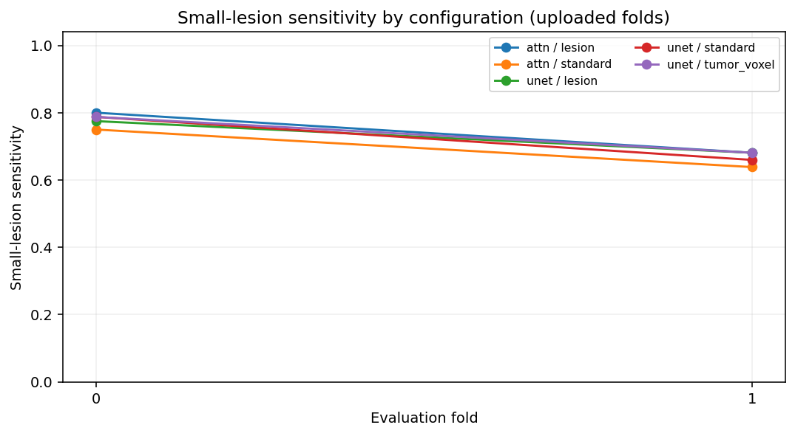
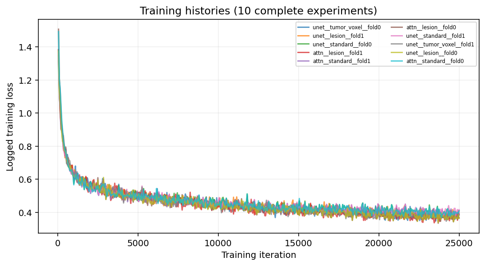
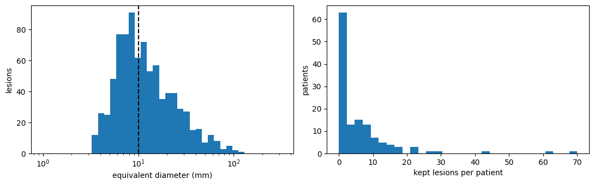
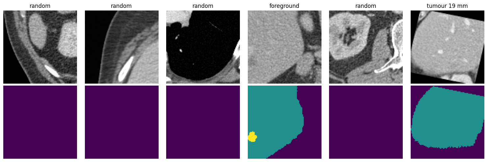

# Liver Lesion Segmentation with Lesion-Aware Sampling

3D liver CT segmentation experiments comparing a conventional **3D U-Net** and an **attention-gated 3D U-Net**, with a focus on detecting small liver tumours. The main comparison evaluates whether sampling patches uniformly by lesion improves sensitivity relative to sampling by tumour voxel or ordinary foreground sampling.

## Overview

This project uses the **Medical Segmentation Decathlon Task03_Liver** dataset (CT scans with liver and tumour annotations). Its label convention is `0 = background`, `1 = liver`, `2 = tumour`.

- **Architectures:** 3D U-Net and attention U-Net (two high-resolution skip gates).
- **Sampling:** standard foreground/random sampling, tumour-voxel sampling, or lesion-uniform sampling.
- **Preprocessing:** RAS reorientation, spacing 1.0 × 1.0 × 1.5 mm, CT window [−200, 250] HU, foreground crop.
- **Targets:** connected tumour components at least 20 mm³, lesions under 10 mm equivalent diameter are considered small.
- **Evaluation:** a planned five-fold patient-level cross-validation, lesion detection sensitivity, tumour/liver Dice, false positives per scan, FROC, and paired patient bootstrap contrasts.
- **Protocol:** main experiments use 25,000 training iterations per configuration/fold, with optional eight-way mirror test-time augmentation and secondary liver-masked analysis. Only main-experiment results are reported here.

## Uploaded experiment results (folds 0 and 1)

Ten complete experiment batches were supplied: U-Net with standard, lesion, and tumour-voxel sampling (two folds each), and attention U-Net with standard and lesion sampling (two folds each). Each has model weights, a training log, and case, lesion, and FROC CSVs for the original and liver-masked evaluations. **These values come from the uploaded result files and are not independently re-computed model predictions.**

The following metrics aggregate the available runs only. Sensitivities pool detected/total lesion counts, Dice scores and false positives are averaged across the two fold-level estimates. Tumour Dice is averaged over cases with non-missing values. Results are descriptive, not the planned full five-fold cross-validation estimate.

| Architecture | Sampler | Folds | Scans | Small-lesion sensitivity | All-lesion sensitivity | FP/scan | Tumour Dice |
|---|---|---:|---:|---:|---:|---:|---:|
| attn | lesion | 2 | 53 | 0.756 | 0.858 | 5.58 | 0.639 |
| attn | standard | 2 | 53 | 0.709 | 0.844 | 5.00 | 0.642 |
| unet | lesion | 2 | 53 | 0.740 | 0.858 | 6.47 | 0.623 |
| unet | standard | 2 | 53 | 0.740 | 0.848 | 5.35 | 0.632 |
| unet | tumor_voxel | 2 | 53 | 0.748 | 0.872 | 6.93 | 0.634 |
Full-resolution metrics (including liver Dice) are in [`results/tables/uploaded_experiment_summary.csv`](results/tables/uploaded_experiment_summary.csv) and [`results/tables/uploaded_configuration_summary.csv`](results/tables/uploaded_configuration_summary.csv). Raw tables and checkpoint files live in [`experiments/`](experiments/). The plots below were derived from the supplied CSVs:









### Incomplete third-fold upload

`experiments/unet_standard_fold2/` has only `last.pt` and `train_log.csv` (logged through iteration 2,050). The final model state, case-level metrics, lesion-level metrics, and FROC outputs for this fold were not provided, so this run is **excluded from all aggregate result tables and plots**.

### GitHub and Git LFS

The trained weights are large, and `unet_standard_fold2/last.pt` is over GitHub's 100 MB normal Git file limit. **Install Git LFS before committing**:

```bash
git lfs install
git init
git add .
git commit -m "Add liver lesion segmentation experiments and results"
git branch -M main
git remote add origin https://github.com/YOUR_USERNAME/YOUR_REPOSITORY.git
git push -u origin main
```

The `.gitattributes` file tracks `experiments/**/*.pt` through Git LFS, check your LFS storage/bandwidth allowance first. If you prefer a lightweight GitHub repo, omit the `.pt` files from the Git push and publish model weights separately (for example, as release assets or in a model registry). **Model weights are provided in separate checkpoint archives**, not in this source-and-results ZIP.

### Reproducibility notes

The `scripts/` pipeline writes new runs under `runs/` using single-underscore run names and the notebook's original defaults and planned five-fold setup. The imported records under `experiments/` are curated snapshots and are not automatically read by the existing report command. Use the CSV summaries above for the supplied results. The source data volumes, original `folds.json`, and completed remaining folds are necessary for a full independent reproduction.

## Dataset observations and main-run baseline recorded in the notebook

The original notebook contains a dataset census and saved visualizations. The following dataset statistics and single-fold baseline are recorded observations, not a completed five-fold cross-validation result.

| Dataset statistic | Recorded value |
| --- | ---: |
| CT volumes | 131 |
| Evaluable tumour lesions (≥20 mm³) | 838 |
| Small lesions (<10 mm) | 391 |
| Patients with small lesions | 73 |
| Cases with no retained lesion | 13 |
| Tiny components excluded from lesion-wise evaluation | 33 |

The notebook records the following **main-run U-Net / standard-sampling, fold-0** baseline (25,000 iterations, 27 scans, with tumour Dice calculated on 23 scans containing a tumour annotation):

| Mean liver Dice | Mean tumour Dice | Mean false positives / scan |
| ---: | ---: | ---: |
| 0.926 | 0.619 | 8.741 |

The broader comparison for the uploaded main-experiment results is reported above. The notebook also retains earlier exploratory work for provenance, but those preliminary results are deliberately excluded from this README's analysis. The revised evaluation workflow uses mirror test-time augmentation, so outcomes from different evaluation passes may not be directly comparable.

### Figures

**Lesion size distribution and per-patient lesion counts** (directly extracted from the notebook output):



**Augmented training image and segmentation patches** (directly extracted from the notebook output):



Original numerical outputs are preserved in `results/reported/notebook_observations.txt`, selected summaries are in `results/tables/`.

## Repository layout

```text
liver-lesion-sampling/
├── src/liver_lesion/
│   ├── config.py              # experiment settings
│   ├── preprocessing.py       # orientation, resampling, lesion census, splits
│   ├── dataset.py             # 3D patch sampling and augmentation
│   ├── models.py              # 3D U-Net and attention gates
│   ├── training.py            # training loop and checkpointing
│   ├── evaluation.py          # inference and lesion/scan metrics
│   └── reporting.py           # FROC and paired bootstrap reports
├── scripts/
│   ├── preprocess.py
│   ├── train.py
│   ├── evaluate.py
│   └── report.py
├── notebooks/
│   └── liver_lesion_experiments.ipynb
├── experiments/                 # uploaded checkpoints and CSVs (Git LFS weights)
├── results/
│   ├── figures/               # exported notebook figures
│   ├── tables/                # recorded dataset and baseline summaries
│   └── reported/              # recorded notebook console output
├── data/raw/                  # datasets excluded from Git
├── data/preprocessed/         # cached numpy arrays excluded from Git
├── runs/                      # checkpoints and run CSVs excluded from Git
├── tests/
├── requirements.txt
└── pyproject.toml
```

## Installation

Python 3.10–3.11 is recommended. Use a compatible CUDA-enabled PyTorch build if you plan to train on GPU, GPU training is strongly recommended for the configured 96³ patches.

```bash
python -m venv .venv
source .venv/bin/activate            # on Windows: .venv\Scripts\activate
pip install -r requirements.txt
pip install -e .
```

## Dataset setup

Download **Task03_Liver** from the [Medical Segmentation Decathlon project](http://medicaldecathlon.com/) and extract its contents to `data/raw/Task03_Liver/`:

```text
data/raw/Task03_Liver/
├── imagesTr/
│   ├── liver_0.nii.gz
│   └── ...
└── labelsTr/
    ├── liver_0.nii.gz
    └── ...
```

Or set an absolute location:

```bash
export LIVER_DATA_DIR=/absolute/path/to/Task03_Liver
```

The medical imaging volumes and all derived subject-level arrays are excluded from Git. Check the dataset license and attribution requirements before redistribution.

## Running the pipeline

Start at the repository root after installation:

```bash
python scripts/preprocess.py
python scripts/train.py --fold 0 --architecture unet --sampler standard
python scripts/evaluate.py --fold 0
python scripts/report.py
```

For the planned full five-fold main experiment, run `python scripts/train.py` without fold filters, using the main configuration (25,000 training iterations). The original scripts retain an optional exploratory mode, but that mode is not part of this repository’s reported results. Change `NUM_WORKERS`, `BATCH_SIZE`, and other parameters in `src/liver_lesion/config.py` as needed for your hardware, and document changes when comparing runs.

Checkpoints and per-case/per-lesion/FROC CSVs are written under `runs/<experiment>/<architecture>_<sampler>_fold<index>/`. A completed evaluation writes `froc_livermask.csv` last. Reporting writes aggregate CSVs and a `froc_curve.png` to `runs/<experiment>/results/` (or `results_livermask/` for the secondary analysis).

Use `python scripts/report.py --liver-mask` for the secondary analysis. Reporting requires completed evaluated runs, it will not invent missing results. For tests, run `pip install pytest` followed by `pytest -q`.

## Experiment design notes

The primary intended controlled comparison is **uniform lesion sampling vs tumour-voxel sampling** under the same nominal tumour-centred crop fraction. Standard sampling and attention-gated models provide additional controls. Tumour lesions are defined using 26-connected components after resampling, a lesion is detected when at least 10% of its voxels are covered by the thresholded tumour prediction. Lesion-level thresholds run from 0.05 to 0.95, with 0.5 as the primary operating point.

Cross-validation splits are stored in the generated `folds.json` to keep them stable across runs. Retain this file privately with your experiment records to reproduce exact assignments, the input notebook did not contain the complete split mapping. Preprocessed arrays are not included. Uploaded checkpoints for completed folds 0 and 1, plus an incomplete fold 2 checkpoint, are available under `experiments/` via Git LFS.

## Notebook

`notebooks/liver_lesion_experiments.ipynb` contains the original experiment workflow and recorded outputs with machine-specific paths replaced by placeholders. It preserves exploratory and revised code sections as an archival record, **the results presented in this README are main-only**. The modular Python package is the maintained command-line entry point. Notebook execution is not required to run the packaged pipeline.

## Limitations

This repository is an experimental research workflow, **not a clinically validated diagnostic tool**. Raw scans, complete patient split definitions, and folds 2–4 evaluation results have not been supplied. The evaluation CSVs were summarized and plotted, but model inference and training were not independently re-executed as part of packaging.
